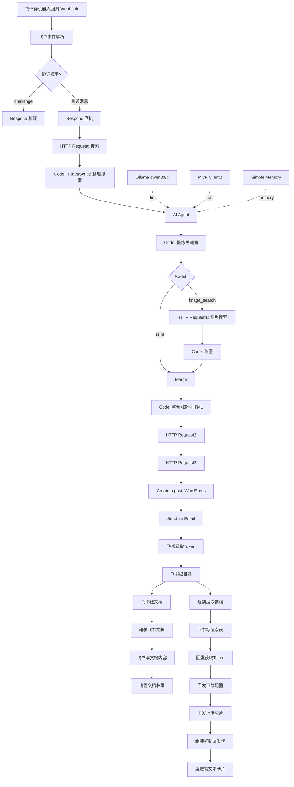

# n8n 飞书存档机器人（群 @ 触发 · AI 简报 · 图文归档）

> 在飞书群里 `@机器人 <任意主题>`，自动完成：**联网搜索 → AI 生成 ~2000 字简报 → 抓取配图 → 发邮件 → 发 WordPress → 建飞书文档并开放权限 → 写入飞书多维表格 → 群内回发图文卡片**。
>
> 本项目是完整的 n8n 工作流 + 部署/运维脚本 + 说明文档，可直接导入 n8n 复现。

---

## ✨ 功能特性

| 能力 | 说明 |
|---|---|
| **群内 @ 触发** | 飞书自建应用事件订阅 `im.message.receive_v1`，Webhook 回调，含 `url_verification` 握手 |
| **联网搜索** | 通过自建 SearXNG 搜索（`categories=general`），聚合多源信息 |
| **AI 简报** | Ollama `qwen3:8b` 生成约 2000 字结构化简报（每节 ≥300 字） |
| **配图** | SearXNG `categories=images` 按 AI 提炼的关键词抓图，每关键词 3 张 |
| **邮件推送** | n8n Email 节点发送 HTML 简报 |
| **WordPress 归档** | 通过 REST API 创建文章（图片回链走公网隧道基址） |
| **飞书文档归档** | 建 docx 文档、写入正文、设置 `anyone_readable` + `external_access` 公开可读 |
| **飞书多维表格** | 把搜索结果/简报元数据写入 Base 数据表 |
| **群内回发** | 组装 `post` 富文本卡片（标题 + 图 + 摘要），上传图片拿 `image_key` 后发群 |

---

## 🏗️ 架构与数据流



### 关键第三方依赖
- **飞书开放平台**（自建应用）：`tenant_access_token`、`im/v1/messages`、`im/v1/images`、`drive/v1/permissions`、`bitable`
- **SearXNG**：自建元搜索（`http://searxng:8080/search`）
- **Ollama**：本地大模型（`qwen3:8b`）+ MCP 工具（`host.docker.internal:3001`）
- **WordPress**：REST API 发文
- **cpolar / 隧道**：对外暴露 WP 图片基址（域名会变化，见 `scripts/refresh_public_urls.py`）

---

## 📁 目录结构

```
n8nfeishucundangv2/
├── README.md                     # 本文件
├── .env.example                  # 环境变量模板（复制为 .env 填真实值）
├── .gitignore
├── workflow/
│   └── wf8_feishu_groupbot.json  # ★ 脱敏版工作流（可公开，导入 n8n 用）
├── docs/
│   ├── TUTORIAL.md               # 节点级详尽教程（逐节点：作用/参数/上下游/机理）
│   └── CHANGELOG.md              # 变更日志
├── scripts/
│   ├── sanitize_workflow.py      # 把运行版工作流脱敏为可公开版
│   └── ...                       # 运维/诊断辅助脚本
├── automation/
│   ├── daily_sync.ps1            # 每日同步（脱敏 → 提交 → 推送）
│   ├── install_task.ps1          # 注册 Windows 计划任务
│   └── push_now.bat              # 手动一键同步
└── （本地运行版 wf8_feishu_groupbot.json、*.sqlite、.env 等不入仓）
```

---

## 🚀 快速开始

### 0. 前置条件
- 已运行 n8n（Docker 或本机）
- 已运行 SearXNG、Ollama（`qwen3:8b`）、WordPress
- 飞书自建应用（开启机器人能力 + 事件订阅 `im.message.receive_v1` + 权限：im/message、drive/file、bitable 等）

### 1. 导入工作流
n8n → **Workflows → Import from File** → 选择 `workflow/wf8_feishu_groupbot.json`。

> ⚠️ 仓库中的工作流是**脱敏版**，凭据为占位符（`YOUR_FEISHU_APP_ID` 等）。导入后需在相关节点里替换为真实值（或改用 n8n 凭据/环境变量）。

### 2. 配置环境变量
```bash
cp .env.example .env
# 编辑 .env，填入真实 FEISHU_APP_ID / FEISHU_APP_SECRET / FEISHU_CHAT_ID / WP_PUBLIC_BASE
```

### 3. 替换工作流中的占位符
在工作流 JSON（或 n8n UI）中把以下占位符替换为真实值：

| 占位符 | 含义 |
|---|---|
| `YOUR_FEISHU_APP_ID` | 飞书应用 App ID |
| `YOUR_FEISHU_APP_SECRET` | 飞书应用 App Secret |
| `YOUR_FEISHU_CHAT_ID` | 目标群 chat_id（`oc_` 开头） |
| `YOUR_CPOLAR_HOST` | WP 图片公网基址域名 |

### 4. 配置飞书事件订阅
开放平台 → 事件与回调 → 请求地址填：`https://<你的n8n域名>/webhook/<workflowId>/webhook`，订阅 `im.message.receive_v1`。

### 5. 启用并测试
激活工作流，在群里 `@机器人 测试主题`，观察各节点执行。

---

## 🔐 安全说明（重要）

- 仓库中的工作流**不含任何真实密钥**，敏感值统一替换为占位符。
- 真实密钥只保存在本地：
  - 本地运行版 `wf8_feishu_groupbot.json`（已被 `.gitignore` 忽略）
  - `.env`（已被忽略）
- 每次同步前 `scripts/sanitize_workflow.py` 会自动把运行版转成脱敏版再提交，**保证密钥永不进入 Git 历史**。
- 若曾误提交密钥，请立即在飞书开放平台**重置 App Secret**。

---

## 🔄 每日自动同步到 GitHub

`automation/` 提供开箱即用的每日同步：

```powershell
# 手动同步一次（脱敏 + 提交 + 推送）
automation\push_now.bat

# 注册为每日 23:30 自动运行（管理员 PowerShell 执行一次）
powershell -ExecutionPolicy Bypass -File automation\install_task.ps1
```

同步逻辑（`daily_sync.ps1`）：
1. 运行 `sanitize_workflow.py` 生成脱敏版；
2. `git add -A`；
3. **仅当有变更时**才 `commit` + `push`（"如果更新了才同步"）；
4. 日志写入 `logs/sync-*.log`。

> 首次推送前需配置 git 远程与凭据：
> ```bash
> git remote add origin https://github.com/<你的用户名>/<仓库名>.git
> git push -u origin main   # 用 PAT 或已登录的凭据助手
> ```

---

## 🧰 脚本说明

| 脚本 | 作用 | 入仓 |
|---|---|---|
| `scripts/sanitize_workflow.py` | 运行版 → 脱敏版（从 `.env` 读真实值，校验无残留 + JSON 合法） | ✔ |
| `automation/daily_sync.ps1` | 每日同步主脚本（脱敏→提交→推送） | ✔ |
| `automation/install_task.ps1` | 注册 Windows 计划任务 | ✔ |
| `automation/push_now.bat` | 手动一键同步 | ✔ |
| 运维/诊断脚本（`_diag/`） | 刷新公网基址、修历史文档权限、E2E 校验等 | ✘ 本地环境 |

> 说明：`_diag/` 里的运维脚本含临时凭据与本地数据库路径，属本机环境，整体不入仓；仓库只保留通用、脱敏的 `sanitize_workflow.py`。

---

## 📝 变更日志

见 [docs/CHANGELOG.md](docs/CHANGELOG.md)。

## 📄 许可

内部项目，未指定开源许可。如需开源请补充 `LICENSE`。
